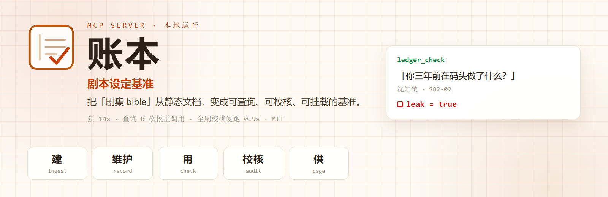

<div align="center">



# 账本 · Ledger

**剧本设定基准 —— 把「剧集 bible」从一份静态文档，变成可查询、可校核、可挂载的基准。**

建基准 → 随写随维护 → 落笔前判断 → 全剧校核 → 供任何 agent 查询。
其中最锋利的一条判据是：**这个角色，在说这句话的时候，该知道这件事吗？**

[](LICENSE)
[](package.json)
[](https://modelcontextprotocol.io)
[](https://kbkb628.github.io/ledger/)

[在线演示](https://kbkb628.github.io/ledger/) · [为什么不能只靠大模型](#为什么不直接让大模型再读一遍) · [判定层 JEV](#判定层用决策模型jev更快更省准确率没掉) · [评测数字](#数字可复现) · [设计文档](docs/design.md)

</div>

---

## 30 秒看懂

```
写手想写：  沈知微：你三年前在码头做了什么，你自己清楚。

agent 调用：ledger_check { line, character: "沈知微", scene: "S02-02" }

返回：      ⛔ leak = true
            「你三年前在码头做了什么」→ 陆见深三年前在码头做了某件事
            全剧没有记录 沈知微 得知过这条命题
```

它**不重读剧本**。建账时把「谁、在第几集、知道了什么」抽出来冻结成一本可查的账，
之后每一次判断都只查账 —— **0 次模型调用，毫秒级**。

| | 建账（一次性） | 查询（每次落笔） | 全剧审计 |
|---|---|---|---|
| 耗时 | 23 场 **14 秒** | **毫秒级**、不调模型 | 首次 67.6s，复跑 **0.9 秒** |
| 产出 | 命题 · 说法 · 知识状态 | 拦住 / 放过 + 成因 | 清单 + 一键豁免 |

「基准」不是一次审稿，是贯穿全程的五件事：

| 基准的五个动作 | 工具 | 做什么 |
|---|---|---|
| **建**基准 | `ledger_ingest` | 全剧抽出命题、说法，记下谁在第几场得知 |
| **维护**基准 | `ledger_record` | 每写完一场就并入；别名与豁免逐场累积 |
| **用**基准 | `ledger_check` | 落笔前判断一条台词 |
| **校核**基准 | `ledger_audit` | 全剧扫成清单：哪句是「没交代就用了」 |
| **供**基准 | `ledger_page` · MCP | 任何 agent / 工具可查一条命题的全部说法与判决 |

---

## 它解决什么

AI 短剧的工具已经很多，但它们管的是**成本**（花了多少钱、哪一步要重做）。
**没人管「故事讲得对不对」。**

```
第 2 集   沈知微：你三年前在码头做了什么，你自己清楚。
第 3 集   （闪回）观众才知道当年码头发生了什么 —— 而那一场，她不在场。
```

编剧一眼看得出，机器看不出来：判断它需要**跨全剧的认知状态**。
上下文塞不下 80 集；就算塞得下，模型也不会替你记「谁在第几场得知了什么」。
所以这件事被做成一个**常驻的 MCP server**，在落笔的当下拦一下。

---

## 为什么不直接让大模型再读一遍

差别不在模型更强，在**账本这一层结构**。

| 维度 | 纯文档 / 提示词约定 | 大模型逐句校准 | **账本（MCP）** |
|---|---|---|---|
| 判据在哪 | 靠模型自觉读规范，读没读不确定 | 每次重读剧本、重新推理，结论不落盘 | 一次建账冻结；判据是数据 |
| 上下文成本 | 无约束 | 每句带全本或摘要，集数越长越贵越不稳 | 一句一查，**只取命中那几条** |
| 可复现 | 无 | 采样抖动，同问两答 | 账本 + 三戳 ⇒ 同问同答 |
| 可审计 / 纠错 | 无 | 「我觉得穿帮」不可核对 | 每条带命题与成因；误报 `ledger_waive` 记流水 |
| 挂载点 | 提示词里的一句提醒 | 直接调 API，无统一入口 | MCP 一行配置，工具级强制查；**本地运行，剧本不出机器** |

---

## 判定层用决策模型（JEV）：更快、更省，准确率没掉

建账时每来一条新说法要判「是不是同一个事实」，写台词时还要判「这个使用点算不算数」——这些**判定**没有换成通用大模型，而是走 TypeSafe 的**决策概率模型（JEV）**。

同一套黄金集（48 条人工标注，别名时序过滤后）：

| 判定器 | 准确率 | 单次延迟 | $ / 1000 次 |
|---|---|---|---|
| 规则（实体词匹配） | 16.7% | < 1 ms | 0 |
| **JEV（默认）** | **91.7%**（44/48） | **0.234 s** | **$0.0446** |
| DeepSeek v4-pro（开思考） | 95.8%（46/48） | 5.68 s | $5.86 |

差 2 条，McNemar `p = 0.50`（**噪声，不是能力差**）；但 **快 24 倍、便宜 131 倍**。
「快」和「省」在这里不是锦上添花：判定要嵌在**建账**与**每次落笔**中间，慢了就不敢每句都查。

一个真实量级（同一本冻结账本，253 个使用点全判一遍）：

| | 耗时 | 花费 |
|---|---|---|
| JEV | **63 s** | **$0.0084** |
| 换成大模型判官（按上表单价折算） | ≈ 24 分钟 | ≈ $1.48 |

另外它只返回 `选择 + 概率`，所以能直接设否决阈值、结果可复现 —— 通用大模型给你的是自由文本。

> 诚实说明：**没有**做「大模型逐句裁判」与账本端到端的对等 A/B，所以不宣称整体准确率更高；这里比较的是**判定层选型**。
> 另外 R1 的召回目前只有 30% 左右（dev 集），**误报控制、可复现与本地运行**才是它的强项。

---

## 快速开始

```bash
git clone https://github.com/kbkb628/ledger && cd ledger
npm install
cp .env.example .env          # 填 JEV_API_KEY 与 JUDGE_*（见下）

npm run mcp                   # 仓库内开发：tsx 起 stdio server
npm run mcp:smoke             # 用真 MCP 客户端走完整路径（≈25s）
```

打成可安装的包（esbuild 单文件，node ≥ 20，不需要 tsx）：

```bash
npm run build && npm pack     # → ledger-0.1.0.tgz
npx -y ./ledger-0.1.0.tgz     # 任意目录里都能起 server
```

> 尚未发布到 npm registry（`private: true`），所以 `npx -y ledger-mcp` 要等发布之后才成立。

<details>
<summary><b>挂到 DeepSeek Harness（DSH）</b></summary>

```yaml
- insert:
    - id: mcp-ledger
      name: '@deepseek-ai/dsh-mcp-client'
      config:
        serverName: ledger
        transport: stdio
        command: node
        args: ['/abs/path/to/ledger/dist/mcp.js']
        cwd: '/abs/path/to/your/script-project'   # 从这里读 .env 与 .ledger
        toolCallTimeoutMs: 180000
```
</details>

<details>
<summary><b>挂到 Claude Code</b></summary>

```bash
claude mcp add --scope user ledger node /abs/path/to/ledger/dist/mcp.js \
  -e JEV_API_KEY=... -e JEV_BASE_URL=... -e JEV_MODEL=... -e LEDGER_HOME=/abs/path/to/.ledger
```
> `-e` 是可变参数，必须放在命令之后，否则会把 `<name>` 一起吃掉。
</details>

**需要的 key**

| 变量 | 用途 |
|---|---|
| `JEV_API_KEY` | 归并判定 / 使用点校验（TypeSafe System One，决策概率） |
| `JUDGE_BASE_URL` · `JUDGE_API_KEY` · `JUDGE_MODEL` | 逐场抽取（任何 DeepSeek 兼容接口） |
| `LEDGER_JUDGE_PROVIDER=openai` | 可选：把**判定层**也换成 OpenAI 兼容模型（用上面那组 `JUDGE_*`）。TypeSafe 按地区返回 451（`Typesafe is not available in your region`）时用这个 —— **不自动降级**，换了判定器就是另一种账本，得自己知道 |

抽取默认**关思考**（开着单场 47s / $0.0162，关掉 2s / $0.0019）。
判定层默认 JEV：48 条黄金集上 91.7% vs 大模型 95.8%（差 2 条、p=0.50），但**快 24 倍、便宜 131 倍** —— 换成大模型判官后，23 场建账会慢到撞穿 MCP 的 60s 超时，这时把 `INGEST_MAX_SCENES` 调小、分批续跑。

---

## 六个工具

| 工具 | 作用 |
|---|---|
| `ledger_ingest` | 首次建账并冻结。**分块可续跑**：一次没建完会返回剩余场次，再调一次接着建 |
| `ledger_record` | 把**一场**新戏增量并入（不重扫全本） |
| **`ledger_check`** | **写完一句台词之前调用** —— 是否构成知识泄漏 |
| `ledger_audit` | 全剧清单，每条带成因 |
| `ledger_page` | 读一条词条：全部说法 · 首见场景 · 谁何时得知 · 判决流水 |
| `ledger_waive` | 人工豁免误报，理由进流水（豁免是产品的一环，不是补丁） |

---

## 数字（可复现）

所有数字都绑在**测试集版本戳 + 打分器戳 + 账本指纹**上，跨集不可比 —— 这是它和「感觉还行」的区别。

| 指标 | 值 |
|---|---|
| 判定层（人工账本，48 样本） | **44/48（91.7%）**；openai 兼容判定器复跑 45/48 |
| 真实剧本 #1 ·《茶馆》72 场（零标注） | **7 条 / 269 使用点（2.6%）**，`chaguan@3` |
| 真实剧本 #2 ·《竇娥冤》元杂剧（零标注） | **7 条 / 165 使用点（4.2%）**，`doueyuan@2` |
| 跨剧本留出集（另一份自洽正本，10 条） | P 28.6% / R 20.0%（已解封 3 次，不再用于选版本） |
| 机制探针 · 幻影集（同事实两种说法） | phantom **1/8** · anchored **7/8** |
| 端到端（命题级，K=3） | 均值 25.67/48（53.5%），**95% Wilson 39.6–66.8%** |

比例指标一律带 95% Wilson 区间；配对比较用 McNemar，不一致对 < 6 不下结论；
`real` 只在**同一份冻结账本**上比较（重抽噪声 ≈±1–2 条）。
完整回合记录见 [`docs/rsi-protocol.md`](docs/rsi-protocol.md)。

**已知不可解的一类**：「在问细节」与「在暗示自己知道」在词法上不可分
（词表 / 判定层 / 问句三条路都试过并失败，记录在案）。所以 `ledger_waive` 是正式出口。

---

## 它是怎么做的

```
剧本 markdown ──► 逐场抽取（LLM）──► 命题 + 逐字说法 + 谁在本场得知
                                          │
                                    归并（确定性两层 + 判定器）
                                          │ 同一事实的多种说法 ⇒ 一条词条（别名累积）
                                          ▼
                              账本 ledger.json（词条 · 知识状态 · 使用点）
                                          │
        ┌─────────────────────────────────┼──────────────────────────────┐
        ▼                                 ▼                              ▼
   ledger_check（写时）             ledger_audit（全剧）            ledger_page（人读）
   说法 → 命题 → 该角色知情时序      使用点 → 知识时序 → 成因        词条全貌 + 判决流水
```

三条累积通道（这是「wiki」真正的价值）：**剧本 → 归并别名增长 → 审计结论回写**。
账本落在 `LEDGER_HOME`（默认 `cwd/.ledger`）：`ledger.json` + `decisions.jsonl`。

---

## 仓库地图

| 路径 | 职责 |
|---|---|
| `src/mcp/server.ts` | 六个工具；建账按块抽取 + 只归并一次，可续跑；判定失败即中止（不落降级账本） |
| `src/extraction/` | 切场 · 逐场抽取 · 归并（bigram blocking + 确定性层 + 判定） |
| `src/audit/` | 使用点构造与校验 · 知识时序 · 泄漏判定 · 使用点缓存（第三条回写通道） |
| `src/store/file-store.ts` | 账本与流水落盘 |
| `eval/` | 5 套剧本级测试集 + 判定层黄金集 + 所有评测脚本（全部可复现） |
| `evalsets/` · `experiments/` | 测试集版本注册表 · 逐回合实验记录（每回合一条 JSON） |
| `docs/` | 在线演示页（`index.html`）、设计文档、评测纪律（`rsi-protocol.md`）、交接说明 |
| `docs/diagrams/` | 架构图 / 数据流图 / 走查图（可交互 HTML） |

---

## 文档

| 文件 | 内容 |
|---|---|
| [`docs/design.md`](docs/design.md) | 总体设计：认知层、事件同一性、三层路由、promotion、审计规则 |
| [`docs/rsi-protocol.md`](docs/rsi-protocol.md) | **主文档**：评测纪律（两类回合 / 红线 / 三戳）+ 逐回合记录，含被自己推翻的结论 |
| [`docs/调研分析.md`](docs/调研分析.md) | **调研报告**：公开报道 / 学术议程 / 方案扫描 / 自有实验四路调研，推导「这个产品为什么应当存在」 |
| [`docs/roadmap.md`](docs/roadmap.md) | 后续改进路线：分阶段 + 验收标准 |
| [`docs/后续路线.md`](docs/后续路线.md) | **以 RSI 为主的评测路线**：五零件、预注册、数字纪律、下一轮计划 |
| [`docs/handoff.md`](docs/handoff.md) | 交接：当前基线、可复现命令、已知坑 |
| [`docs/testset.md`](docs/testset.md) | 测试集规范与演进日志 |
| [`docs/extraction-schema.md`](docs/extraction-schema.md) | 抽取层字段定义 |

---

## 技术栈

TypeScript · `@modelcontextprotocol/sdk`（stdio）· esbuild 单文件打包 ·
判定：TypeSafe JEV（决策概率）· 抽取：DeepSeek 兼容接口 · 存储：JSON / JSONL（无数据库）

## 许可

**MIT** —— 代码、文档、评测集一并用 MIT，见 [`LICENSE`](LICENSE)。

第三方素材：`eval/script-chaguan.md`（老舍《茶馆》，1957；作者 1966 年去世，依中国著作权法已进入**公有领域**，
文本由 `eval/import-chaguan.ts` 从 [Wikisource](https://zh.wikisource.org/) 转录页转换）；
`eval/script-doueyuan.md`（關漢卿《竇娥冤》，元，公有领域）。
